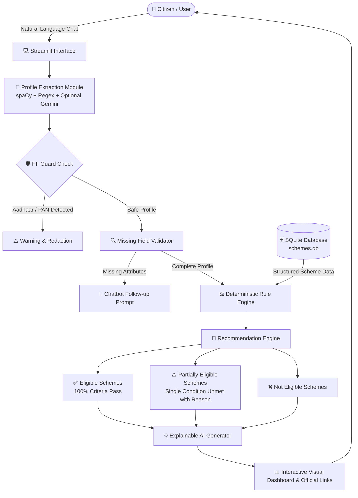

# 🏛️ GovSchemeBot: AI-Powered Government Scheme Eligibility & Recommendation Chatbot

> **An Explainable, Privacy-First AI & Rule Engine System for Discovering Indian Government Schemes**  
> *Developed for MCA AI & Data Science Portfolio & Hackathon Demonstration.*

---

## 📌 Project Overview

Millions of citizens miss out on life-changing welfare programs due to fragmented information, complex guidelines, and lack of eligibility clarity. **GovSchemeBot** solves this by offering a conversational, explainable, and trustworthy assistant that discovers government schemes tailored to a user's profile.

### ⚖️ Core Architectural Principles
1. **AI NEVER Decides Eligibility:** The system guarantees **0% hallucination** in eligibility decisions. Eligibility is computed exclusively by a deterministic Python Rule Engine.
2. **AI / NLP Role:** Natural language query understanding, entity/attribute extraction (`spaCy`, Regex, optional Gemini LLM), asking follow-up questions for missing parameters, and formatting plain-English explanations.
3. **Privacy & Security by Design:** Strict Zero-PII policy. The system never asks for or stores Aadhaar numbers, PAN cards, bank passwords, or biometric information. Built-in security guards proactively detect and warn users against entering financial credentials.
4. **Data Trustworthiness:** Grounded in structured official data (`data.gov.in`, `myscheme.gov.in`). Every single recommendation provides direct links to the official government portal, document checklists, and explicit legal disclaimers.

---

## 🏗️ System Architecture



---

## 🛠️ Tech Stack

| Layer | Technology | Purpose |
|---|---|---|
| **Frontend** | Streamlit | Responsive web UI with interactive chat, dashboard tabs, metrics, and cards |
| **Backend** | Python 3.12 | Core application logic, modular services, and evaluation rules |
| **Database** | SQLite3 & Pandas | Secure relational database with parameterized queries and CSV ingestion |
| **NLP & Entity Extraction** | spaCy & Regex | Offline entity recognition for age, income expressions, states, and categories |
| **Generative AI (Optional)**| Google Gemini API | Optional conversational refinement (works 100% offline if omitted) |
| **Security** | Regex PII Guards | Real-time pattern detection for Aadhaar, PAN, and bank credentials |

---

## 📂 Project Structure

```
GovSchemeBot/
├── app.py                  # Main Streamlit web application
├── database.py             # SQLite database layer with parameterized queries
├── chatbot.py              # Conversational manager & dialog coordinator
├── eligibility.py          # Deterministic Rule-Based Eligibility Engine
├── recommender.py          # Categorizes recommendations (Eligible / Partial / Not Eligible)
├── extractor.py            # Natural Language profile & entity extraction module
├── init_db.py              # Standalone database population script
├── test_bot.py             # Automated end-to-end test suite
├── requirements.txt        # Python package dependencies
├── .env.example            # Environment variable template for optional Gemini API
├── README.md               # Project documentation & presentation guide
├── data/
│   └── schemes.csv         # Structured dataset with 28 realistic Indian government schemes
└── database/
    └── schemes.db          # Auto-generated SQLite database
```

---

## 📊 Dataset Specifications

The dataset includes **28 central and state government schemes** across **15 ministries**, covering:
- **Higher Education & Scholarships:** Post-Matric Scholarships (SC/ST/OBC), Central Sector Scheme, PM Research Fellowship (PMRF), AICTE Pragati Scholarship for Girls, Saksham Scholarship for Specially-Abled Students, National Overseas Scholarship.
- **Microfinance & Entrepreneurship:** PM MUDRA Yojana, Stand Up India Scheme, PM SVANidhi (Street Vendors), PM Vishwakarma (Artisans), PMEGP, Startup India Seed Fund Scheme, CGTMSE.
- **Agriculture & Farmers:** PM-KISAN, PM Fasal Bima Yojana (PMFBY), Kisan Credit Card (KCC).
- **Social Security & Housing:** PM Awas Yojana (Urban & Rural), Ayushman Bharat (PM-JAY), Atal Pension Yojana (APY), Sukanya Samriddhi Yojana (SSY), Mahila Samman Savings Certificate, Indira Gandhi National Old Age Pension Scheme.

Each scheme record contains:
- `scheme_id`, `scheme_name`, `ministry`, `description`
- `min_age`, `max_age`, `max_income`
- `eligible_categories`, `eligible_occupations`, `eligible_states`, `eligible_genders`, `disability_required`
- `required_documents`, `official_url`, `data_source`, `last_updated`

---

## 🚀 Quickstart & Setup Instructions

### 1. Prerequisites
- Python 3.10, 3.11, or 3.12 installed on your system.

### 2. Clone / Open Directory
Open PowerShell or Terminal in the project directory:
```bash
cd C:\Users\URUSHALI\.gemini\antigravity\scratch\GovSchemeBot
```

### 3. Install Dependencies
```bash
pip install -r requirements.txt
```

*(Optional) Download spaCy English model for enhanced entity recognition:*
```bash
python -m spacy download en_core_web_sm
```

### 4. Initialize Database
Create the SQLite schema and populate the 28 schemes from CSV:
```bash
python init_db.py
```

### 5. Run Automated Tests
Verify all 7 test suites pass:
```bash
python test_bot.py
```

### 6. Launch Application
Run the Streamlit web dashboard with a single command:
```bash
streamlit run app.py
```
Open your browser at `http://localhost:8501`.

---

## 🎯 Sample Conversational Demonstrations (Hackathon Demo Script)

### Scenario 1: MCA Student (Portfolio Benchmark)
**User Input:**
> *"I am a 22 year old MCA student from Maharashtra. My family income is 2 lakh. I belong to OBC category."*

**Chatbot Output:**
- **Profile Extracted:** Age: 22 | State: Maharashtra | Occupation: Student | Income: ₹2,00,000 | Category: OBC
- **Eligible Schemes:**
  - *Central Sector Scheme of Scholarship for College and University Students*
  - *Prime Minister Research Fellowship (PMRF)*
  - *National Apprenticeship Promotion Scheme (NAPS)*
  - *Ayushman Bharat (PM-JAY)*
- **Partially Eligible Scheme Highlight:**
  - *Post-Matric Scholarship for OBC Students* (⚠️ Reason: Maximum income cap is ₹1,50,000; user income is ₹2,00,000).

---

### Scenario 2: Small Farmer in Uttar Pradesh
**User Input:**
> *"I am a 38 year old farmer from Uttar Pradesh. My annual income is 1 lakh."*

**Chatbot Output:**
- **Eligible Schemes:**
  - *PM-KISAN* (Direct income transfer of ₹6,000/yr)
  - *Pradhan Mantri Fasal Bima Yojana (PMFBY)* (Crop insurance)
  - *Kisan Credit Card (KCC)*
  - *Atal Pension Yojana (APY)*

---

### Scenario 3: Woman Entrepreneur Seeking Loans
**User Input:**
> *"I am a 29 year old woman entrepreneur looking for business capital."*

**Chatbot Output:**
- **Eligible Schemes:**
  - *PM MUDRA Yojana* (Loans up to ₹5 Lakhs collateral-free)
  - *Stand Up India Scheme* (Loans ₹10 Lakhs to ₹1 Crore for women entrepreneurs)
  - *Startup India Seed Fund Scheme (SISFS)*

---

## 🛡️ Security & Privacy Audit

1. **SQL Injection Prevention:**
   All queries in `database.py` use strictly parameterized SQL queries (`?` parameter substitutions). No user string is ever interpolated directly into SQL statements.
2. **PII Protection:**
   Regex guards in `extractor.py` actively detect Aadhaar numbers (12-digit regex), PAN cards (alphanumeric pattern), and payment card numbers. The bot rejects and alerts the user without persisting the data.
3. **Environment Security:**
   API keys are loaded through environment variables or Streamlit secrets, preventing hardcoded credentials.

---

## 📜 Disclaimer
This project is an academic prototype developed for demonstration and research purposes. All recommendations are advisory. Final approvals and welfare disbursements are strictly governed by the official portals and designated officers of the Government of India.
